<p align="center">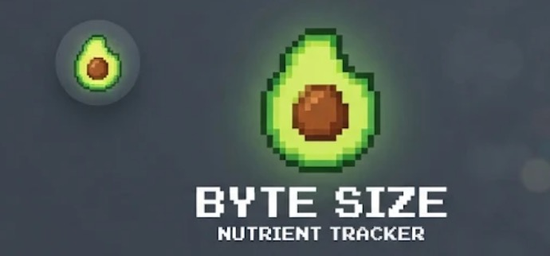</p>

# ByteSize

A self-hosted nutrition tracker with a web app and a native iPhone app. It was built for weight loss on a GLP-1, so
it uses a calorie *range* instead of a hard cap and puts protein, fiber and water front and center. One server
holds everyone's data, kept separate for each person.

## Why this exists

ByteSize started as a way to **replace a subscription-based food-tracking app** with something I own, run on my own
server and can change whenever I want. The paid app did the basics, but custom foods were hard to create, find and
edit, foods weren't tied to their barcodes, and entries couldn't be moved to another day or meal. Rather than keep
paying and living with that, the goal was to build a replacement, **using AI to help write the code**.

> **Built mostly with AI.** Almost all of ByteSize's code (the Node/TypeScript server, the React web app, the
> SwiftUI iPhone app, the tests and the GitHub Actions pipelines) was written by an AI coding assistant (Claude),
> working from plain-language design notes and feedback. The human side was deciding what to build, reviewing
> designs, testing every round on real devices and saying what to change. Read the code with that in mind, and
> treat it as an example of what AI-assisted development can produce.

## Screenshots

### Web app

| Dashboard | Track food |
|---|---|
| 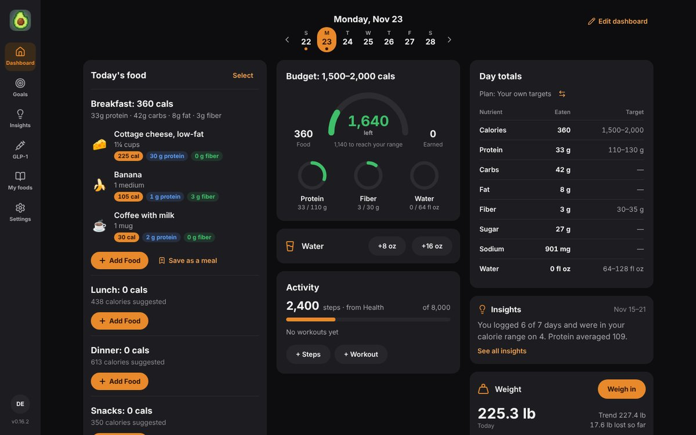 | 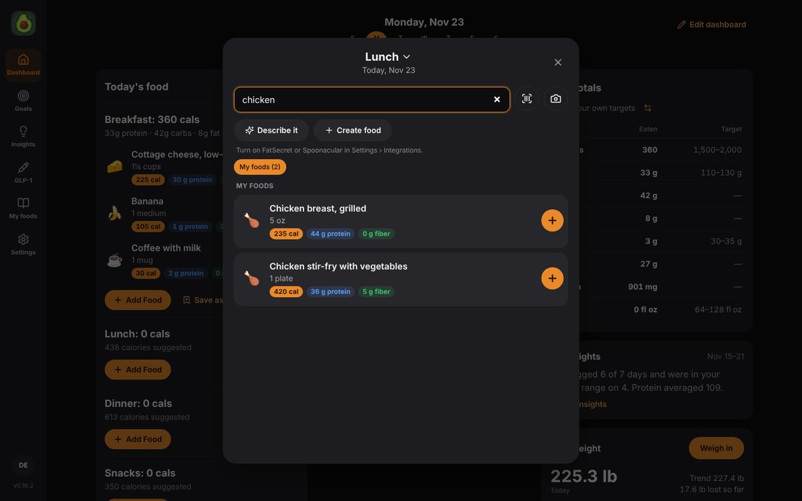 |
| **Goals** | **Insights** |
| 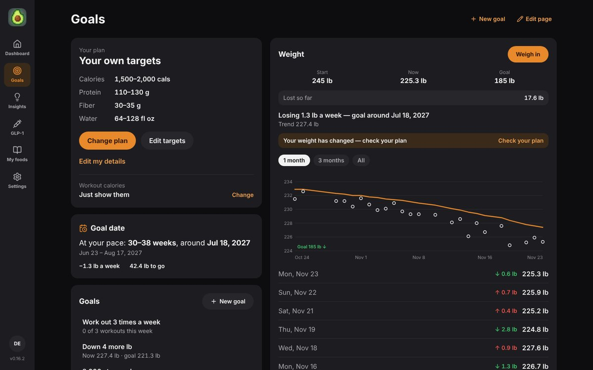 | 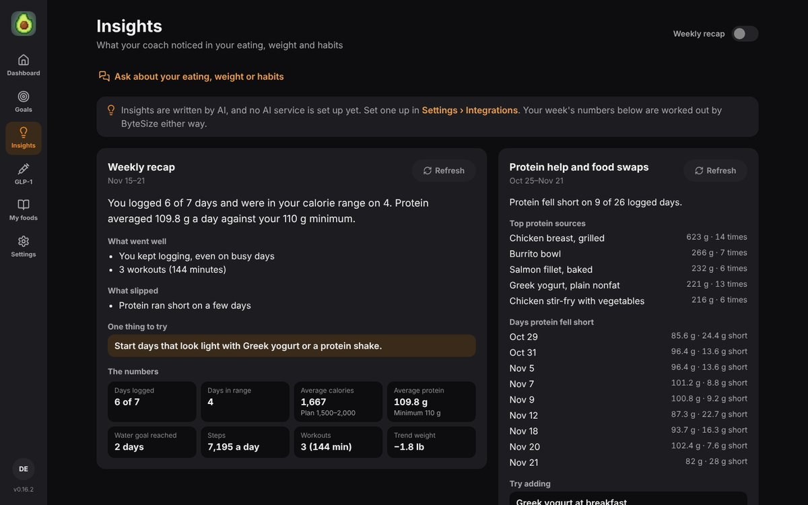 |
| **GLP-1** | **My foods** |
| 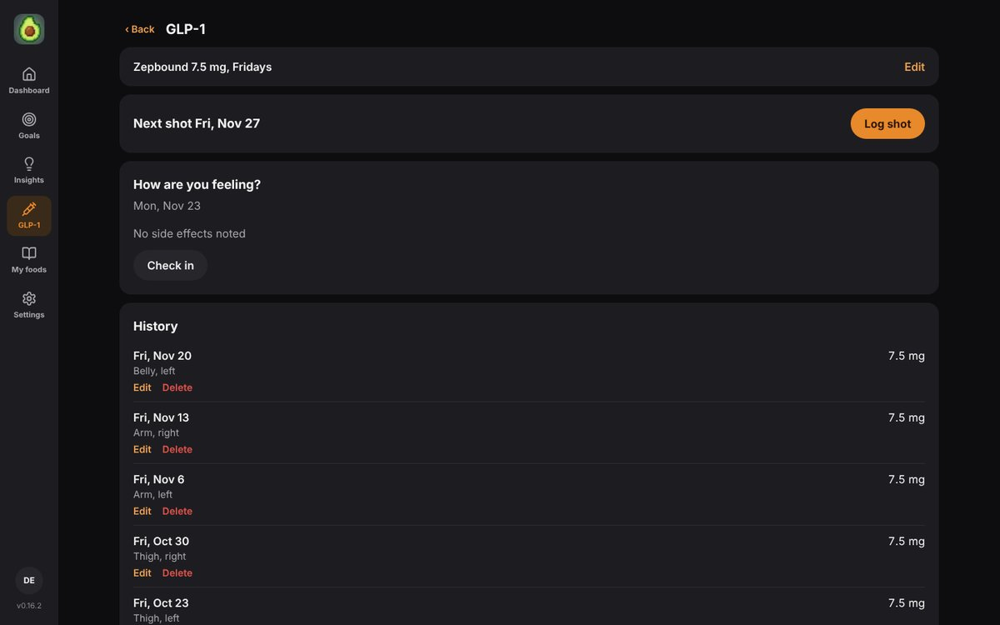 | 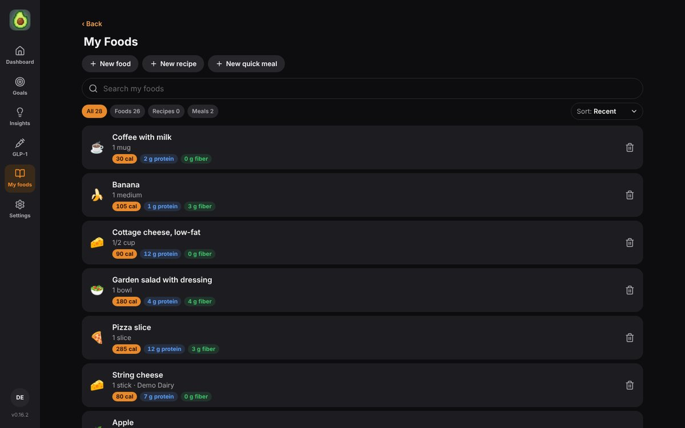 |
| **Settings › Integrations** | |
| 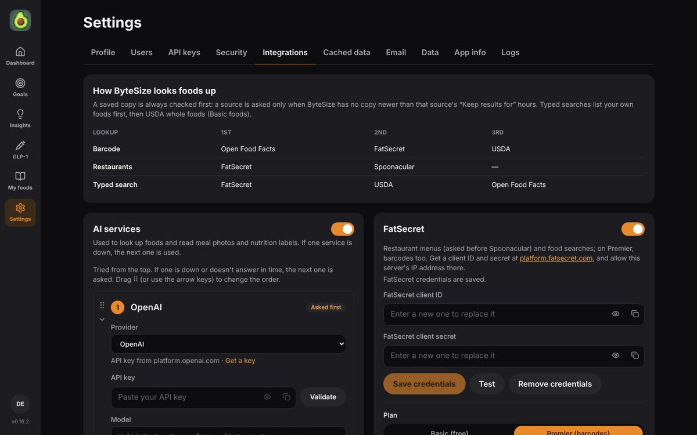 | |

*Web screenshots use the built-in demo data (`npm run seed-demo`).*

### iPhone app

| Dashboard | Food log | Track Food | My Foods | Goals |
|---|---|---|---|---|
| 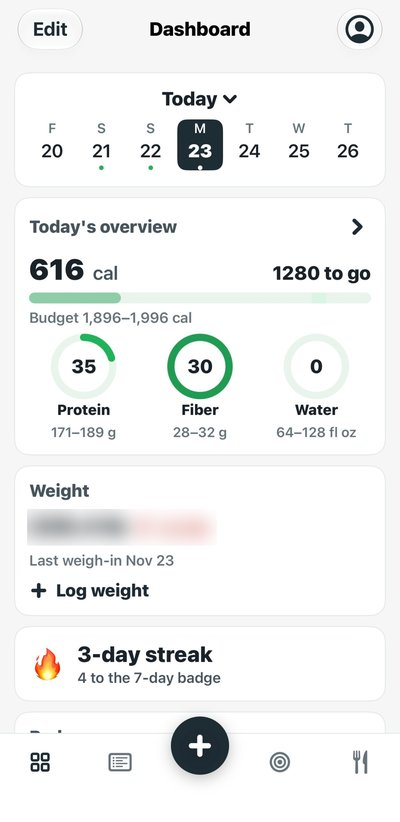 | 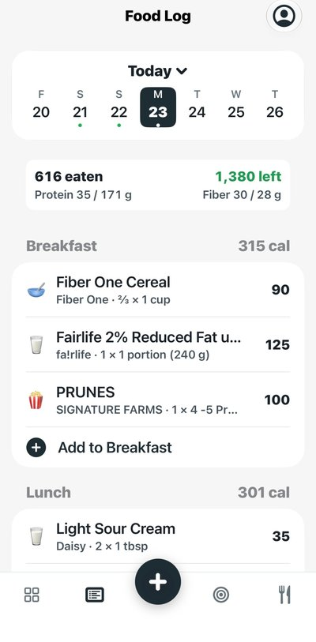 | 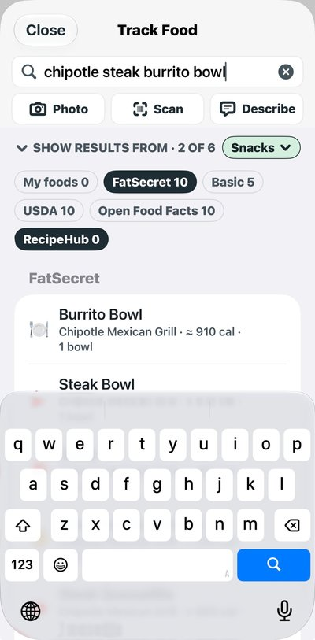 | 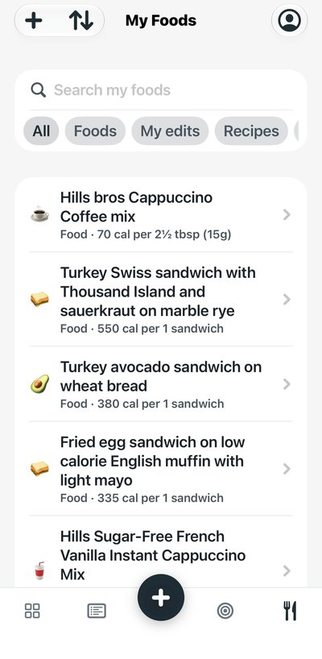 | 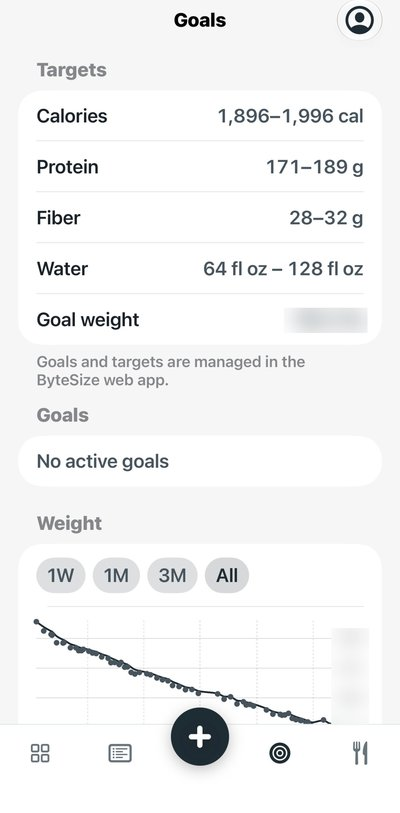 |

*Weight numbers are blurred in the iPhone screenshots.*

## What it does

- **Plan picker:** enter your height, weight, goal, age and activity (and whether you're on a GLP-1) and it offers four
  plans, Relaxed to Vigorous, with a safe, GLP-1-aware "Recommended for you". Your plan sets a calorie *range* plus
  protein, fiber and water targets (editable under Goals). Plans apply from the day you pick until you change them,
  so past reports stay correct.
- **Dashboard:** the day's food log by meal, a calorie gauge counting down to the top of your range,
  protein/fiber/water rings that fill to their minimums, quick water buttons, steps and workouts, weight trend,
  logging streak and badges. It's built from widgets you can rearrange (Edit dashboard).
- **Fast logging:** add food from recents, search, a barcode (scanned on the iPhone, or a photo of one on the web), a
  photo of your plate or a nutrition label, or **Describe it** ("two eggs and toast"), logged as one meal or as
  separate items. Use ¼ ⅓ ½ ¾ portions, and move or copy entries to another day or meal.
- **My foods:** create foods (with a barcode), recipes and quick meals, and fix any database food. Your correction
  sticks to that barcode.
- **Goals:** weight goal with a trend line and a goal date at your current pace (shown as a range), plus habit and
  activity goals (logging days, protein, water, steps, workouts) with start/end dates and past goals.
- **GLP-1:** medication and dose, shot day reminders in the app, injection-site history and side-effect check-ins.
- **Insights:** an AI coach's weekly recap, protein help with food swaps, and a chat to ask about your eating, weight
  or habits. The numbers are worked out by ByteSize; the AI only writes the words.
- **Import weight history:** Settings › Data › Import weight history reads a CSV (up to 5 MB) from Lose It,
  MyFitnessPal, Happy Scale, Libra, Withings, Fitbit or your own sheet, shows a preview, then adds the weigh-ins.
  Apple Health only exports XML: use an app that exports Health data as CSV (for example Health Auto Export, metric
  "Weight & Body Mass"), or use the iPhone app, which reads weight from Health directly.
- **Self-hosting extras:** sign-in with passwords, passkeys or OAuth / OpenID Connect, Forgot password by email,
  admin-managed accounts and email invites, daily backups and restore, personal API keys, activity logs.

## Data sources and how they're used

ByteSize doesn't come with its own food database. It asks public food databases and, if you set one up, an AI service.
Everything goes through **your ByteSize server**: the web app and the iPhone app never call these services
themselves, and the keys stay encrypted on the server (with `JWT_SECRET`). The admin turns each source on or off and
enters its keys in **Settings › Integrations**.

| Source | What ByteSize uses it for | Key | Results kept for (default) |
|---|---|---|---|
| **Your own foods** | Foods, recipes and quick meals you made, and your corrections to database foods. Always searched first. | none | always |
| **[Open Food Facts](https://world.openfoodfacts.org)** | Packaged foods and barcodes (open, crowd-sourced data). | none | 9999 h |
| **[USDA FoodData Central](https://fdc.nal.usda.gov)** | Whole foods ("Basic", from the Foundation and SR Legacy data) and US branded foods and barcodes. | free ([sign up](https://fdc.nal.usda.gov/api-key-signup)) | 9999 h |
| **[FatSecret](https://platform.fatsecret.com)** | Restaurant menus and typed searches. On the paid **Premier** plan, barcodes too (switch Basic/Premier in settings). Your server's IP address must be allowed in the FatSecret account. | client ID + secret | 24 h |
| **[Spoonacular](https://spoonacular.com/food-api)** | Restaurant menu items (US chains), asked after FatSecret. The free plan's 50 points a day is plenty for one person. | API key | 1 h |
| **RecipeHub** (optional, per person) | Your own recipe/meal-planning app: pick items from your meal plan or search your recipes while logging. Read-only. | per-person key | n/a |
| **AI services** | Plate photos, nutrition-label photos, **Describe it**, serving-size estimates, and Insights. Supports OpenAI, Claude (Anthropic), Gemini, OpenRouter and a local server (Ollama, LM Studio). List several and the next one is tried if one is down. | per service | n/a |
| **Apple Health** (iPhone only) | Reads weight, steps and workouts. A weigh-in already in ByteSize wins; Health only fills empty days. Health workouts become ByteSize workouts. Nothing is written back to Health. | none | n/a |

**Lookup order** (also shown at the top of Settings › Integrations; a source that's off is skipped). A saved copy is
always checked first, and typed searches list your own foods and USDA Basic foods before the sources below:

| Lookup | 1st | 2nd | 3rd |
|---|---|---|---|
| Barcode | Open Food Facts | FatSecret (Premier only) | USDA |
| Restaurants | FatSecret | Spoonacular | — |
| Typed search | FatSecret | USDA (branded) | Open Food Facts |

**Local first.** Every outside answer (barcodes, foods, typed and restaurant searches) is saved on your server and
reused until that source's "Keep results for" hours run out (1–9999, editable per source). The defaults follow each
source's terms: open data (Open Food Facts, USDA) can be kept for as long as you like, while FatSecret allows 24 hours
and Spoonacular 1. A food from a kept copy shows "Saved copy from <date>" with **Check for changes**. An hourly
cleanup removes old copies except foods someone is using. The admin's **Saved barcodes** card lists, refreshes and
deletes kept barcodes. When a barcode turns up in more than one source, ByteSize shows a short list so you can pick
the right product.

**Missing numbers count as 0.** Databases often leave nutrients blank; ByteSize treats unknown values as 0 in totals
rather than showing "unknown".

## Run it (Docker)

```
mkdir bytesize && cd bytesize
curl -O https://raw.githubusercontent.com/cwland/ByteSize/main/docker-compose.yml
curl -o .env https://raw.githubusercontent.com/cwland/ByteSize/main/.env.example
# edit .env: POSTGRES_PASSWORD, and JWT_SECRET (make one with: openssl rand -base64 48)
docker compose up -d
```

Open `http://<server>:4100`. The first visit asks you to set up the admin account. There is no sign-up page:
the admin adds everyone else in Settings › Users.

- Data lives in `./data` (`./data/postgres` for the database, `./data/app` for photos and backups).
- Health check: `GET /health` → `{"ok":true,"db":true,"version":"…"}`.
- Behind Nginx Proxy Manager / Traefik: proxy to port 4100. Passkeys need `https://` (or `localhost`);
  set `PASSKEY_ORIGINS=https://bytesize.example.com` to allow only your address.
- iPhone app passkeys: set `IOS_APP_ID` to your Apple Team ID and the app's bundle ID
  (`ABCDE12345.com.cwland.bytesize`). See [Passkeys on the phone](#6-passkeys-on-the-phone-optional).

### Backups

ByteSize backs up the whole server (everyone's data and photos) once a day, soon after 03:00 server time (`TZ` in `.env`),
into `./data/app/backups` as `bytesize-<date>-<time>.tar.gz`. The newest 14 are kept. `BACKUP_HOUR` and
`BACKUP_KEEP` in `.env` change that (`BACKUP_KEEP=0` turns the daily backup off). The server checks every hour,
so if it was off at 03:00 it backs up when it's next running. The admin can also back up, download, delete
and restore in Settings › Data. Copy the backups folder somewhere else with your usual backup tools.
Foods that turned up in a search but that nobody logged, starred, corrected or put in a recipe aren't kept in backups.

A restore replaces everything on the server with the backup. A `…-before-restore` backup is saved first, and
everyone has to sign in again afterwards.

Restore onto a fresh server: start ByteSize, create the first admin account, then Settings › Data › Restore from
a file. Keep the same `JWT_SECRET` as the old server: saved keys (AI, USDA, Spoonacular, FatSecret, RecipeHub) only
open with it. With a different one, Settings › Data lists the keys to enter again.
Behind a reverse proxy, restoring a large backup file needs the proxy's upload size limit and timeout raised.

### Email

Settings › Email (admin) sets up the account ByteSize sends email from: pick Gmail, Outlook, iCloud, Fastmail or
your own server, then the from address, username and password (Gmail, iCloud and Fastmail need an *app password*).
The server, port and security are under More options. **Send test email** has to go through before **Save**.
The password is stored encrypted with `JWT_SECRET` and never shown unless you press the eye. Sent emails are
listed in Settings › Logs (Email).

`SMTP_HOST`, `SMTP_PORT`, `SMTP_USER`, `SMTP_PASS`, `MAIL_FROM` and `APP_URL` in `.env` still work: they are used
when nothing is saved in Settings › Email.

### Forgot password

With email set up, the sign-in screen shows **Forgot password?**. Enter the email on your account; if an account
uses it, ByteSize emails a 6-digit code (the screen says the same either way, just as quickly). Enter the code and a new password and
you're signed in; every other device is signed out. A code works once, for 15 minutes; 5 wrong tries end it, and
asking again replaces it. At most 5 codes an hour per email and per address, and 10 code tries an hour per email. Accounts without an email, and
turned-off accounts, never get a code. Each reset is in Settings › Logs (who, never the code).

### Invite by email

With email set up, Settings › Users › **Invite by email** (admin) adds a person by name, username and email and
emails them a link to choose their own password. They show as **Invited** until they do; **Resend** sends a new
link (the old one stops working) and **Cancel invite** removes them. A link works once, for 7 days. It points at
ByteSize's address from Settings › Email (or `APP_URL`), else the address the admin is using.

### OAuth sign-in

Settings › Security › OAuth sign-in (admin) lets people sign in with Authentik, Keycloak, Google, Microsoft or any
OpenID Connect provider:

1. At the provider, make an OAuth2 / OpenID application with the **Redirect URI** shown in ByteSize
   (`https://<your ByteSize>/api/auth/oauth/callback`). When ByteSize's address is set (Settings › Email, or
   `APP_URL` / `PASSKEY_ORIGINS` in `.env`), the redirect URI uses it and sign-ins from any other address are refused.
2. In ByteSize: turn it on, name the button, and enter the **Issuer URL**, **Client ID** and **Client secret**.
   Save, then **Test connection**.
3. Everyone (you first) uses **Link my account** in Settings › Security to sign in with the provider once.

The sign-in screen then shows **Sign in with …**. It only signs in accounts their owners linked with **Link my
account**; emails are never matched. OAuth never creates accounts: the admin adds people in Settings › Users.
**OAuth only** hides the password form (passkeys still work); it can only be turned on once your own account is
linked at that provider, and it turns itself off when you change the provider or the client ID.

### API keys

Settings › API keys lets each person make keys for their own tools (Home Assistant, n8n, Shortcuts, scripts), up
to 20. A key works as its owner only, never as an admin. **Read only** reads your day, foods, My Foods, weight,
GLP-1, goals and trends; **Read and log** can also add, edit and delete log entries, water, weigh-ins and shots.
Send it as `Authorization: Bearer <key>`:

```sh
curl -H "Authorization: Bearer bs_…" https://<your ByteSize>/api/day/2026-11-18
curl -X POST -H "Authorization: Bearer bs_…" -H "Content-Type: application/json" -d '{"water_ml": 250}' https://<your ByteSize>/api/log
```

No key can reach admin, settings or integrations, API keys, backups or Download my data, any "show a saved key"
route, or sign-in, devices, passkeys and passwords. A key gets 120 requests a minute. Keys are stored encrypted
with `JWT_SECRET` (so the eye can show them again) and as a hash; a backup plus that `JWT_SECRET` can read them.

### Locked out?

Reset a password from the server (no email needed). Without a username it resets the first admin. It prints a new
random password once (add `--password` to be asked for one instead, or set `NEW_PASSWORD`; a password is never given
as an argument) and signs that account out everywhere:

```
# Docker
docker compose exec -u node bytesize npm run reset-password -- <username>
# Mac (or any machine running from the source)
cd backend && npm run reset-password -- <username>
```

### Try it with a few months of data

Fill an existing account (the first admin unless you name one) with about 90 days of food, water, weigh-ins (245 lb
trending down) and weekly GLP-1 shots. It never creates an account. If the account already has tracking it stops;
`--replace` deletes that account's entries, weigh-ins, water, shots and the foods this command made, then fills it
again, so you can run it over and over (it also deletes that account's Undo records for combined entries; earned
badges are left as they are). Nothing else is touched, except what filling sets, which it prints under "Also set":
the body weight (follows the latest weigh-in), the GLP-1 settings, three App info counts (and a starter profile if
the account has none); `--replace` resets these too. Options: `--user <username>`, `--days <7-365>`, `--replace`.

```
# Docker
docker compose exec -u node bytesize npm run seed-demo -- --replace
# Mac (or any machine running from the source)
cd backend && npm run seed-demo -- --replace
```

Locked out by OAuth (OAuth only, and the provider is down)? Turn OAuth only and OAuth sign-in off:

```
# Docker
docker compose exec -u node bytesize npm run auth:reset
# Mac
cd backend && npm run auth:reset
```

Or add `EMERGENCY_DISABLE_OAUTH=true` to `.env` and restart: the server does the same at every start. Remove it
once you're back in.

## Develop

Needs Node 22 and PostgreSQL 16 (or `docker compose -f docker-compose.dev.yml up -d`, which creates
`bytesize` and `bytesize_test`).

```
npm run setup                     # installs root, backend and frontend
cp backend/.env.example backend/.env
npm run dev                       # API on :4100, web app on :5173
npm test                          # backend (real Postgres test DB) + frontend
```

Every push to GitHub runs the tests; pushes to `main` publish `ghcr.io/cwland/bytesize:latest` (linux/amd64).

## Build the iPhone app

The iPhone app is a SwiftUI app for iOS 17 or later, in the [`ios/`](ios) folder. It's a companion to your ByteSize
server, not a standalone app: you sign in with your server's address, username and password. Account setup, goals and
targets stay in the web app. The phone handles day-to-day tracking: Dashboard, Food log, Track Food (search, barcode
scan, plate and label photos, Describe it), My Foods, Goals, and Apple Health.

How it's organized:

- `ios/ByteSizeKit/`: a Swift package with all the app's logic (API client, models, Health import), tested with `swift test`.
- `ios/ByteSize/`: the app target, views only.
- `ios/project.yml`: an [XcodeGen](https://github.com/yonaskolb/XcodeGen) spec. The Xcode project is generated and not committed.
- `ios/Config.xcconfig` (committed) and `ios/Local.xcconfig` (yours, git-ignored): your Team ID and server address.

### What you need

- A Mac with **Xcode** (the CI uses Xcode 27) and the iOS Simulator installed from Xcode › Settings › Components.
- **Homebrew** and **XcodeGen**: `brew install xcodegen`.
- To run on a real iPhone: an Apple ID signed in under Xcode › Settings › Accounts. A paid **Apple Developer
  Program** membership is recommended: it's needed for passkeys (Associated Domains) and TestFlight, and builds don't
  expire after 7 days as they do with a free account.
- A running ByteSize server (see [Run it](#run-it-docker)) that the phone can reach. Use `https://` for passkeys;
  plain `http://` on your home network is fine for password sign-in.

### 1. Get the code and set your values

```sh
git clone https://github.com/cwland/ByteSize.git
cd ByteSize/ios
cp Local.xcconfig.example Local.xcconfig
```

Edit `ios/Local.xcconfig`:

```
DEVELOPMENT_TEAM = ABCDE12345          // your Apple Team ID (developer.apple.com › Account › Membership)
CODE_SIGN_STYLE = Automatic
PASSKEY_DOMAIN = bytesize.example.com  // your server's host name, no https://
```

`Local.xcconfig` is git-ignored, so your Team ID and server address never go into the repository.

If you're building your own copy rather than contributing, change the bundle ID `com.cwland.bytesize` (and
`bundleIdPrefix`) in `ios/project.yml` to one of yours, because bundle IDs are unique per Apple account.

### 2. Generate the Xcode project

```sh
cd ByteSize/ios && xcodegen generate
```

This creates `ByteSize.xcodeproj`. Run it again after pulling changes that add or remove files, or after editing
`project.yml`.

### 3. Run the tests

```sh
cd ByteSize/ios/ByteSizeKit && swift test
cd ByteSize/ios && xcodebuild test -scheme ByteSize -destination 'platform=iOS Simulator,name=iPhone 17'
```

The first runs only the logic tests, in seconds. The second builds the app and runs the unit and UI tests in the
simulator; use any simulator you have installed (`xcrun simctl list devices`).

### 4. Run it

```sh
cd ByteSize/ios && open ByteSize.xcodeproj
```

- **Simulator:** pick an iPhone simulator in the toolbar and press ⌘R. The camera (barcode scanning, photos) doesn't
  work in the simulator; everything else does.
- **Your iPhone:** connect it (or use the same Wi-Fi after pairing once), select it in the toolbar, and press ⌘R. The
  first time, turn on **Developer Mode** on the phone (Settings › Privacy & Security) and, with a free account, trust
  your certificate under Settings › General › VPN & Device Management.
- In Signing & Capabilities, the ByteSize target should show your team, with HealthKit and Associated Domains listed.
  If Xcode reports a signing problem, check `DEVELOPMENT_TEAM` in `Local.xcconfig` and the bundle ID.

On first launch, enter your server address (for example `https://bytesize.example.com`) and sign in.

### 5. Turn on Apple Health (optional)

In the app, tap the profile button (top right) and, under **Apple Health**, turn on Weight, Steps and/or Workouts. iOS
asks for permission to read them (ByteSize never writes to Health). **Sync now** pulls the latest right away. If you said no earlier, change it in the Health app › Sharing › Apps › ByteSize.
A weigh-in already in ByteSize always wins; Health only fills days without one.

### 6. Passkeys on the phone (optional)

Passkeys are created in the web app and then work on the phone at the same address. Two settings must agree:

1. **Server:** set `IOS_APP_ID=<TeamID>.<bundle ID>` (for example `ABCDE12345.com.cwland.bytesize`) in `.env` and
   restart. ByteSize then serves `/.well-known/apple-app-site-association`, which your reverse proxy must pass through.
2. **App:** `PASSKEY_DOMAIN` in `Local.xcconfig` is your server's host name. It goes into the app's Associated
   Domains entitlement (`webcredentials:<host>`).

Without these, the app still signs in with a password.

### 7. TestFlight releases (optional)

Pushing a tag like `ios-v0.10.0` runs `.github/workflows/ios-testflight.yml` on GitHub's macOS runner. It generates
the project, archives a Release build signed automatically with an App Store Connect API key, and uploads it to
TestFlight. The tag sets the version; the run number sets the build number. Ordinary pushes that touch `ios/` run
`ios-test.yml` (logic tests and an unsigned simulator build) instead.

First, create the app in App Store Connect with your bundle ID, and make an App Store Connect API key (Users and Access
› Integrations, **Admin** role). Then add these under the repository's Settings › Secrets and variables › Actions
(nothing personal goes in the repo):

| Name | Kind | What |
|---|---|---|
| `APPLE_TEAM_ID` | secret | your Apple developer Team ID |
| `ASC_KEY_ID` | secret | App Store Connect API key ID |
| `ASC_ISSUER_ID` | secret | App Store Connect issuer ID |
| `ASC_KEY_P8_BASE64` | secret | the key file, base64-encoded: `base64 -i AuthKey_<id>.p8` |
| `PASSKEY_DOMAIN` | variable | your ByteSize server's host name |

```sh
cd ByteSize && git tag ios-v0.10.0 && git push origin ios-v0.10.0
```

### Theme colors

The app's colors are generated from the web app's theme, so the two stay in step:

```sh
cd ByteSize/frontend && npx tsx ../scripts/gen-ios-theme.ts
```
